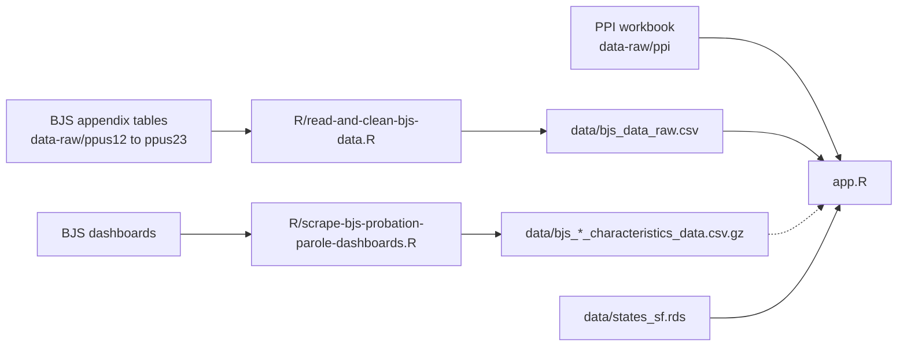

# National Supervision Data Dashboard

An interactive [Shiny](https://shiny.posit.co/) dashboard that tracks people on **probation**, on **parole**, and in **jail or prison** across the United States: every state, the District of Columbia, and the federal system, from 1978 onward. Use it to see how supervision has changed over time, how states compare, and where the underlying data are strongest and weakest.

Maintained by the [REFORM Alliance](https://github.com/REFORM-Alliance).

> **Quick start:** open an R console in this folder, run `renv::restore()` once, then `shiny::runApp()`. See [Getting started](#getting-started).

## Contents

- [What the dashboard shows](#what-the-dashboard-shows)
- [Data](#data)
  - [Sources](#sources)
  - [Why PPI and not BJS for population counts](#why-ppi-and-not-bjs-for-population-counts)
  - [Coverage](#coverage)
  - [How the numbers are calculated](#how-the-numbers-are-calculated)
  - [Data dictionary](#data-dictionary)
  - [Known limitations and issues](#known-limitations-and-issues)
- [Getting started](#getting-started)
- [Project structure](#project-structure)
- [Data pipeline and updating the data](#data-pipeline-and-updating-the-data)
- [How the app is built](#how-the-app-is-built)
- [Deployment](#deployment)
- [Troubleshooting](#troubleshooting)
- [Contributing](#contributing)
- [Credits and citation](#credits-and-citation)

## What the dashboard shows

| Tab | What it is for |
|---|---|
| **Home** | A short writeup of the data, four headline numbers, and three trend charts: the rise and fall of community supervision, how much probation and parole have each changed (in percent) since a reference year (2019 by default), and the spread across states. Every figure is computed from the same data as the other tabs. |
| **Main Dashboard** | A map and ranked bar plot of every state for any supervision type, outcome, and year (or range of years), plus a searchable table you can export as Copy, CSV, or Excel. |
| **State Dashboard** | One state's community supervision, probation, and parole trends compared with the national mean and the population-weighted national median. |
| **National Dashboard** | National population, admissions, and exits over time for community supervision, probation, and parole, as totals or per-100,000 rates. |
| **About** | Ways to use the tool, a searchable glossary of key terms, a data dictionary with a coverage table, and a list of data caveats. |

## Data

All data are **aggregate counts** published by the Prison Policy Initiative (PPI) and the Bureau of Justice Statistics (BJS). There are no individual-level records in this repository.

### Sources

| Source | What it provides | Years | Location in repo |
|---|---|---|---|
| [Prison Policy Initiative](https://www.prisonpolicy.org/blog/2026/06/02/supervision/) | **Population** counts by state and type of supervision or incarceration. Builds on, corrects, and extends BJS data by harmonizing definitions across states and years and filling gaps. See [Why PPI and not BJS](#why-ppi-and-not-bjs-for-population-counts). | 1978–2024 | `data-raw/ppi/incarceration_supervision_by_state_1978_2024.xlsx` ([download from PPI](https://www.prisonpolicy.org/data/incarceration_supervision_by_state_1978_2024.xlsx)) |
| [Bureau of Justice Statistics](https://bjs.ojp.gov/) *Probation and Parole in the United States* | **Admissions** (BJS calls them "entries") and **exits** for community supervision, probation, and parole. | 2012–2024 | `data-raw/ppus12/` … `data-raw/ppus24/` (appendix tables), cleaned into `data/bjs_data_raw.csv` |
| BJS probation and parole dashboards | Demographic and case characteristics (sex, race, offense, and so on). Scraped, and loaded by the app, but **not yet shown in any tab**. | 1994–2022 | `data-raw/probation-demographic-data/`, `data-raw/parole-demographic-data/`, `data/bjs_*_characteristics_data.csv.gz` |
| U.S. Census boundaries | State geometries for the map. | n/a | `data/states_sf.rds` (an `sf` object in EPSG:4326, joined on `state_name`) |

Population estimates used for rates come from the U.S. Census via CDC SEER, as supplied in the PPI workbook.

### Why PPI and not BJS for population counts

BJS is the official federal source for probation and parole data, and the dashboard still uses it for admissions and exits. For **population counts**, the dashboard uses PPI's corrected series instead, because BJS's published state figures have documented problems. PPI's series is not a separate survey: it starts from BJS's files (the annual survey data and state tables) and checks them against state and local sources, such as state agency reports, open-data portals, budget documents, and public-records requests. PPI made corrections to historical data for 21 states.

This reasoning is shown in the app on the Home tab (a short callout) and in **About → Sources & Caveats** (the fuller version, with the table below). It comes from PPI's report: Jacob Kang-Brown, [*Probation and parole trends by state: A look back at the data on "alternatives" to incarceration*](https://www.prisonpolicy.org/blog/2026/06/02/supervision/), Prison Policy Initiative, June 2, 2026. The figures and examples below are PPI's, not the result of analysis in this repository.

| Problem in BJS's published state counts | Example from PPI's report | What PPI did |
|---|---|---|
| Private probation is largely missing | BJS collects it only where a state agency already does; PPI estimates about one in three people on probation in Tennessee is supervised by a private company. | Added outside sources where they exist (state audit and fee data, Human Rights Watch's private-probation data). |
| Coverage changes look like growth | BJS's 2022 survey expansion added local and misdemeanor probation agencies, so Oklahoma, Tennessee, and Virginia appeared to jump. | Rebuilt those series from the best available state and local sources. |
| Definitions change from year to year | Illinois alternately counted and left out administrative-only probation; New Jersey's count fell 77% between BJS's 2022 and 2023 reports. | Reconciled definitions, for example using archived active-probation counts for New Jersey. |
| Imputed values create false spikes | BJS fills in missing values, which can produce one-year jumps; Delaware's reported 85% rise in 2023 is one example that other state sources did not show. | Replaced questionable values with state-source counts, or dropped them and interpolated. |
| State corrections never reach BJS | California, Illinois, Maryland, New York, and Pennsylvania revise their own data, but BJS is not set up to collect revisions. | Used the states' revised figures. |
| Counting units differ | New York's 1990s figures counted cases rather than people. | Used New York State data and interpolated 1987 to 1997. |
| The net effect can be large | Uncorrected BJS data would suggest Illinois cut its community supervision rate by 42% from 2009 to 2024. | PPI's corrected data show about 3% (1,019 to 989 per 100,000). The dashboard's data match this. |

**What this means for users and maintainers**

- PPI's series is more reliable for state trends, but not perfect. PPI itself says Alaska, Idaho, Nevada, and West Virginia remain uncertain; Utah's 2022 to 2024 figures are a clear underestimate (state corrections department only); Georgia's probation rate is likely inflated by duplicate records; and private and local probation coverage is still incomplete in several states.
- Counts in the dashboard may not match BJS's published tables, and BJS's own rates use adult residents rather than all residents.
- **Admissions and exits are not corrected.** PPI's state dataset covers population counts only, so admissions and exits come straight from BJS's imputed series and may carry some of the same issues. They will not always reconcile with the corrected population counts.
- If PPI publishes a new version of its workbook, re-read the table above and update the PPI facts in the `ppi_source` block at the top of `app.R` (the report's title, author and date, and the "21 states" figure, which feed the Home callout, `ppi_vs_bjs_df` and the About text). The Illinois example in the table is recomputed from the workbook.

### Coverage

*As of the current data (PPI workbook version 1.0, last updated June 2, 2026; BJS through 2024). The same table is built live from the data in the app (About → Data Dictionary → "What data are available?"), so it updates itself after a refresh; this copy is a snapshot and should be re-pasted from the app when you refresh.*

| Supervision type | Population | Admissions and exits | Notes |
|---|---|---|---|
| Community Supervision, Probation, Parole | 1978–2024 | 2012–2024 | Population is complete for all 50 states, D.C., and the federal system in every year. Admissions and exits are missing for six state-years (Oklahoma in 2013, Alaska and Oregon in 2015, Georgia and Michigan in 2016, Nevada in 2020 for admissions only), which understates national totals in those years. |
| Prison | 1978–2024 | not available | Complete through 2023. In 2024, six states (Alaska, Connecticut, Delaware, Hawaii, Rhode Island, Vermont) have no prison figure. |
| Jail Custody, Jail Jurisdiction | 1978–2024 | not available | Complete through 2019 (apart from Alaska in 1993). From 2020 on, only 20–26 of the 51 jurisdictions (50 states and D.C.) have data in a given year. |
| Total Incarceration | 1978–2024 | not available | Complete through 2019. From 2020 on, only 26 of 51 jurisdictions, because it needs both jail and prison figures. |

Because of these gaps, the Home tab and the trend charts focus on probation and parole. Treat national incarceration totals from 2020 onward with caution.

### How the numbers are calculated

- **Population** is a point-in-time count taken from PPI. Timing differs by type: community supervision counts are generally as of the end of the year (January 1 of the following year), prison counts are year-end, and jail counts are generally mid-year.
- **Admissions and exits** use the BJS *imputed* series (`entries_imputed`, `exits_imputed`), which BJS estimates for non-reporting states. State-level gaps can remain; see [Coverage](#coverage).
- **Rate per 100,000** is `100000 × count ÷ total resident population`, where the denominator is the state's **all-ages** population from the PPI workbook. BJS publishes its own rates per 100,000 *adult* residents; those are not used here, so rates in this dashboard run lower than BJS's.
- **Combining sources:** BJS rows (admissions and exits only) are stacked with PPI rows (population only) into one table, `ppi_bjs_data`, with a `data_source` column marking each row.
- **National totals** (National Dashboard and Home tab) sum the states, D.C., and the **federal system**. The federal system is left out of the per-capita denominator because its people already live in a state. PPI's own "United States" rows are excluded from sums to avoid double counting.
- **National Mean and National Median** (State Dashboard) are calculated across the states and D.C. only. The mean is unweighted; the median is weighted by state population (`matrixStats::weightedMedian`).
- **Main Dashboard aggregation:** when a year range is selected, each state's yearly values are summarized with the chosen statistic (mean, median, minimum, maximum, or sum for totals). For per-capita medians, each year is weighted by that year's population.
- **Map shading:** states with no data for the current filters are drawn as 0 (the lightest shade). Check the Table to tell a true zero from missing data.
- **Percent change since 2019** (Home tab, Trend 2) is `count ÷ count in 2019 − 1` for each series, so 0% means no change from 2019 and −10% means 10% fewer people than in 2019. The comparison year is `home_base_year` at the top of `app.R`.
- **People on both probation and parole** are counted in each, so they appear twice in the Community Supervision total.

### Data dictionary

The fields in the Table and behind the charts (the About tab has the full version with a searchable glossary):

| Field | Type | Description |
|---|---|---|
| `state_name` (State) | text | The 50 states and D.C. The data also contain `Federal` (the federal system) and `United States` (PPI's national row). |
| `year` (Year) | integer | Calendar year of the figure. |
| `control_type` (Supervision Type) | category | Community Supervision, Probation, Parole, Prison, Jail Custody, Jail Jurisdiction, or Total Incarceration. |
| `outcome_category` (Outcome Category) | category | Population, Admissions, or Exits. Admissions and Exits exist only for Community Supervision, Probation, and Parole. |
| `count` (Count) | number | People (Population) or movements into or out of supervision (Admissions, Exits). |
| `rate` (Rate per 100,000) | number | Count divided by the state's all-ages resident population, times 100,000. Blank for the federal system, which has no population of its own. |
| `total_pop` | number | State resident population (all ages) used as the rate denominator. |
| `data_source` (Data Source) | text | `PPI` or `BJS`. |
| `division`, `region`, `state_fips`, `state_fips_numeric`, `state_abbr`, `ap_abbr` | text | Census division and region and state identifiers, carried over from the PPI workbook. |

### Known limitations and issues

These are documented in the About tab where they affect interpretation. They are listed here so maintainers can decide what to fix.

- **"Total Correctional Control" has no data.** It appears in the Main Dashboard's Supervision Type menu, but those rows are removed during data preparation, so selecting it shows an empty map. Either remove it from the menu or stop filtering it out (and update the glossary entry in `glossary_df`).
- **National Dashboard tooltips say "Per 10k"** while the rates are per 100,000.
- **Year sliders are labeled "Year/Quarter Range"** on the Main Dashboard even though the data are annual.
- **BJS state-level gaps understate national admissions and exits** in affected years. The 2016 dip in the National Dashboard is largely Georgia and Michigan missing that year, not a real drop.
- **Admissions and exits are not corrected the way population counts are.** They come straight from BJS's imputed series (see [Why PPI and not BJS](#why-ppi-and-not-bjs-for-population-counts)), so they can carry the same issues PPI documents and may not reconcile with the population counts.
- **Incarceration coverage thins out from 2020** (see [Coverage](#coverage)).
- **Demographic data are loaded but unused.** `bjs_dem_df` is read at startup but no tab displays it yet.
- **Definitions vary across states.** PPI harmonizes what it can, but states still differ in how they organize probation, parole, jails, and prisons.

## Getting started

### Prerequisites

- **R 4.4** (the lockfile was created with R 4.4.2). RStudio is optional.
- An internet connection the first time you run the app: the theme downloads the Roboto font from Google Fonts and caches it.
- On Linux, the `sf` package needs the system libraries GDAL, GEOS, and PROJ (for example `libgdal-dev libgeos-dev libproj-dev` on Debian/Ubuntu). macOS and Windows binary packages bundle them.

### Install and run

```bash
git clone https://github.com/REFORM-Alliance/national-supervision-data-dashboard.git
cd national-supervision-data-dashboard
```

Then, from an R console started **in the project folder** (or by opening `federal-supervision-dashboard.Rproj` in RStudio):

```r
renv::restore()   # one time: installs the exact package versions in renv.lock
shiny::runApp()   # starts the dashboard
```

Run it from the project folder so that `.Rprofile` takes effect. It activates `renv` and sets `shiny.autoload.r = FALSE`, which keeps Shiny from auto-loading the standalone scripts in `R/` (see [Troubleshooting](#troubleshooting)).

Startup takes a few seconds while the data are read and prepared.

### Configuration

| Setting | Where | Purpose |
|---|---|---|
| `CARTO_API_KEY` | `.Renviron` | Optional. If set, the map uses CARTO's light basemap. If empty or missing, the map falls back to Esri's World Gray Canvas tiles, so the app works without a key. Keep your own key out of version control. |
| `REFORM_DB_HOST`, `REFORM_DB_USER`, `REFORM_DB_PASSWORD`, `REFORM_DB_PORT` | user-level `~/.Renviron` | Only used by `R/read-and-clean-bjs-data.R` to write to the internal Postgres database. Port defaults to 5432. Not needed to run the app. |
| `SUDO_PASSWORD` | environment | Only used by the scraping script `R/scrape-bjs-probation-parole-dashboards.R`, which uses `sudo` to find a free port. Not needed to run the app. |

The app itself needs no database and no credentials.

## Project structure

```
.
├── app.R                      # The entire Shiny app (data prep, UI, server)
├── data/                      # Cleaned inputs the app reads
│   ├── bjs_data_raw.csv                         # Tidy BJS appendix tables (admissions, exits, population)
│   ├── bjs_probation_characteristics_data.csv.gz
│   ├── bjs_parole_characteristics_data.csv.gz   # Demographics (loaded, not yet displayed)
│   ├── states_sf.rds                            # State boundaries for the map
│   ├── community_supervision_pop_by_state.csv   # State ranking extract (not used by the app)
│   ├── blah.csv                                 # Ad hoc extract (not used by the app)
│   └── ad-hoc-data-pulls/                       # One-off data pulls (not used by the app)
├── data-raw/                  # Source files as downloaded, never edited by hand
│   ├── ppi/                   # PPI workbook (population, 1978-2024)
│   ├── ppus12/ ... ppus23/    # BJS "Probation and Parole in the United States" appendix tables, one folder per data year
│   ├── probation-demographic-data/
│   └── parole-demographic-data/
├── R/                         # Standalone scripts. These are NOT app modules
│   ├── read-and-clean-bjs-data.R                      # data-raw/ppus*  ->  data/bjs_data_raw.csv
│   ├── scrape-bjs-probation-parole-dashboards.R       # BJS dashboards  ->  demographic CSVs
│   ├── women-on-supervision.R                         # Ad hoc analysis of women on supervision
│   └── georgia-viz.R                                  # Ad hoc Georgia visualization
├── logs/                      # Screenshots and Selenium log from scraper runs (diagnostic only)
├── renv/, renv.lock           # Reproducible package library (R 4.4.2)
├── manifest.json              # Deployment manifest (see Deployment)
├── .Rprofile, .Renviron       # renv activation, shiny.autoload.r = FALSE, optional map key
└── federal-supervision-dashboard.Rproj   # RStudio project (legacy file name)
```

## Data pipeline and updating the data



`app.R` reads the PPI workbook directly. BJS data go through a cleaning script first. Most scripts in `R/` connect to an internal Postgres database and write to it as well as to CSV, so running them currently requires access to that database. **The app does not.**

### Refreshing PPI population data

1. Download the new workbook from PPI into `data-raw/ppi/`.
2. The app expects a sheet named `data` whose header row starts with `state_name`, with the columns listed in the [data dictionary](#data-dictionary).
3. Update the `ppi_source` block at the top of `app.R` (workbook file name, and the PPI report's title, author, date and "corrected states" count if there is a new report). This block is the only place those facts are typed.
4. Check `available_years` and the Home and About tabs, which pick up the new years automatically (see [How the Home and About text stays in step with the data](#how-the-home-and-about-text-stays-in-step-with-the-data)).

### Refreshing BJS admissions and exits

1. Add the new report's appendix tables to a new `data-raw/ppusYY/` folder. Files are named like `ppus23at05.csv` (appendix table 5 of the 2023 report). The tables can be **CSV or Excel** (`.csv`, `.xlsx`, `.xls`), and a folder can mix the two. If the same table is saved in more than one format, the script uses one copy (CSV first, then `.xlsx`, then `.xls`). For Excel files, put the table on the first sheet.
2. Run `R/read-and-clean-bjs-data.R` to rebuild `data/bjs_data_raw.csv`. The script writes to the internal Postgres database as well, so set `REFORM_DB_HOST`, `REFORM_DB_USER`, and `REFORM_DB_PASSWORD` (and optionally `REFORM_DB_PORT`) in your user-level `~/.Renviron` first. Do not put them in the repo's `.Renviron`.
3. Confirm that the latest year and state coverage look right (see the checklist below). The cleaning script drops a stray footnote letter from state names (the 2024 table printed "Delawared"), and the app repairs any that remain at start-up and says so in its log.

### Checklist after any data refresh

- [ ] The app starts and every tab loads.
- [ ] The app log shows no `Home and About text: ... check(s) failed` warning. If one appears, it names the hand-written sentence or source detail that no longer matches the data (see `home_check_claims()`).
- [ ] The Home tab numbers look plausible. They, the years, the coverage table, the missing state-years, the Illinois example and the wording that depends on a number (up or down, "nearly fourfold", "gradual, then sharper") are all computed live from the data.
- [ ] Update the `ppi_source` block at the top of `app.R` if PPI released a new workbook or report, and `home_base_year` if you want a different comparison year.
- [ ] Re-read the **editorial text**, which the code does not rewrite for you: the Home framing sentences, the glossary, and the PPI examples quoted in `ppi_vs_bjs_df` (Tennessee, New Jersey, Delaware and similar), which come from PPI's report and are not recomputed.
- [ ] Regenerate `manifest.json` (see [Deployment](#deployment)).

## How the Home and About text stays in step with the data

Every number in the Home and About text is looked up from the data rather than typed, in the way an R Markdown report uses inline code: years (`landing_stats$first_year`, `$latest_year`, `$bjs_first_year`, `$bjs_year`), counts, percent changes, the state with the highest and lowest rates, the coverage table (`coverage_note()`), the missing admissions and exits state-years (`bjs_gaps`) and PPI's Illinois example (`il_from`, `il_to`). Words that depend on a number are chosen from it too: "up" or "down", "nearly fourfold" (`fold_phrase()`), "gradual, then sharper", "about half of states", and whether a one-year dip in the national lines is "largely" or "partly" explained by missing states.

What is still typed:

| What | Where | Why |
|---|---|---|
| PPI workbook name; PPI report title, author, date; "21 states corrected"; the report's Illinois comparison years and the uncorrected BJS change | `ppi_source` at the top of `app.R` | Stated in PPI's report, not in the workbook. |
| The reference year for "since ..." comparisons | `home_base_year` | A choice, not a statistic. |
| The other PPI examples (Tennessee, New Jersey, Delaware, Utah, and so on) | `ppi_vs_bjs_df` and the About → Sources & Caveats text | Quoted from PPI's report. |
| Definitions and framing sentences | Throughout | Editorial. |

Two safeguards cover the typed parts. `home_check_claims()` runs when the app starts and prints a warning to the log for each hand-written statement or source detail that no longer matches the data (for example a BJS state name that is not a PPI jurisdiction, or a workbook file name whose years differ from the data). And the app repairs a stray footnote letter on a BJS state name (the 2024 BJS table printed "Delawared") and reports it, so a footnote can never split a state in two.

## How the app is built

`app.R` is a single file. Its sections, in order:

| Section | What it does |
|---|---|
| `Prep for App` | Reads and tidies the PPI workbook, BJS data, and geometries; builds `ppi_bjs_data`; defines the theme and the map basemap helper. |
| `Settings to Review When the Sources Are Updated` | `ppi_source` (workbook file name and the facts from PPI's report that cannot be computed) and `home_base_year`. The only typed source facts. |
| `Home Page Data` | Builds `landing_trend`, `landing_state_rates`, `landing_admissions`, `landing_change` (percent change since the base year, for Trend 2), the `landing_stats` list that feeds the Home text and tiles, the coverage and gap facts behind the About coverage table, the number-dependent wording (`trend1_head`, `trend1_decline`, `trend2_intro`, `trend3_head`), and `home_check_claims()`. |
| `Home & About Page Content` | Page styles (`landing_css`), small HTML helpers, the About tables (`glossary_df`, `fields_df`, `coverage_df`, `controls_df`, `ppi_vs_bjs_df`), and the `home_tab` and `about_tab` objects. |
| `UI` | A `navbarPage` (`id = "main_nav"`) with tabs Home, Main Dashboard, State Dashboard, National Dashboard, About. |
| `Server` | One block of outputs per tab. |

**Key data objects**

| Object | Contents |
|---|---|
| `ppi_bjs_data` | The combined table behind almost every chart: one row per state, year, supervision type, and outcome. |
| `states_sf` | State boundaries for the leaflet map, joined on `state_name`. |
| `bjs_dem_df` | BJS demographic characteristics (loaded, not yet displayed). |

**Main inputs**

| Tab | Input IDs |
|---|---|
| Home | `landing_metric` (count or rate toggle); navigation buttons and links (`go_*`, `next_*`, `why_ppi_more`) |
| Main Dashboard | `supervision_type`, `outcome_category`, `rate_or_count`, `agg_level`, `year_mode_map`, `year_range`, `single_year_map_val` |
| State Dashboard | `state_selection`, `rate_or_count_state`, `year_range_state` |
| National Dashboard | `rate_or_count_national`, `year_range_national` |

**Conventions**

- Section headers use the `####Name####` style.
- Colors follow one scheme throughout: Community Supervision `#E69F00`, Probation `#009E73`, Parole `#0072B2`. These are colorblind-safe and are validated against the app's cream background (`#FDF6E3`).
- The Home tab's Trend 3 bars are shaded by rate with a one-hue orange ramp (`#E69F00` for the lowest rate shown to `#8C3D00` for the highest), so darker means higher. The light end keeps at least 2:1 contrast against the cream background.
- Charts on the Home tab are built with `plotly` directly; the other tabs use `ggplot2` through `ggplotly`.
- Sentences that mix text, numbers, and bold or links are built with the `lp_html()`, `bold()`, and `link_to()` helpers so the browser does not insert stray spaces.

## Deployment

The repo includes a `manifest.json` (written by `rsconnect::writeManifest()`) for Git-backed deployment to Posit Connect-compatible hosts.

1. Make and test your changes locally.
2. Regenerate the manifest so the file checksums and package list match: `rsconnect::writeManifest()`.
3. Commit `app.R`, `manifest.json`, and any changed data, then deploy.

**Important:** `R/` contains standalone scripts, not app code. Shiny auto-loads any `R/` folder next to `app.R` unless `shiny.autoload.r` is `FALSE`, and these scripts load database packages and connect to a database on startup. Locally, `.Rprofile` turns autoload off. If you deploy somewhere that does not read `.Rprofile`, either set the option before the app starts or move the scripts to a folder with another name (for example `scripts/`).

## Troubleshooting

| Symptom | Cause and fix |
|---|---|
| Startup error mentioning `RPostgres` or a database connection | Shiny auto-loaded the scripts in `R/`. Run from the project folder so `.Rprofile` applies, or run `options(shiny.autoload.r = FALSE)` before `shiny::runApp()`. |
| Page will not load, and the console says it needs internet to download Google Fonts | The theme fetches the Roboto font the first time it is built. Connect to the internet once (the font is then cached), or change `font_google("Roboto")` in the theme definition to a system font. |
| The map has no basemap tiles | The tile provider is unreachable or `CARTO_API_KEY` is invalid. Leave the key blank to use the Esri fallback. |
| A state shows as 0 on the map | Either a true zero or missing data. Open the Table below the map and check that state. |
| Admissions or exits show nothing for Prison or Jail | By design: admissions and exits exist only for Community Supervision, Probation, and Parole. |
| `renv::restore()` fails building `sf` on Linux | Install GDAL, GEOS, and PROJ development libraries, then retry. |

## Contributing

1. Create a branch from `main`.
2. Make your change and run the app locally: confirm each tab loads, the Home toggle works, and the About tables render.
3. If you touched the data, follow the [refresh checklist](#checklist-after-any-data-refresh).
4. Open a pull request describing what changed and why. Issues and questions are welcome through GitHub Issues.

## Credits and citation

- **Population data:** [Prison Policy Initiative](https://www.prisonpolicy.org), *Probation and parole trends by state: A look back at the data on "alternatives" to incarceration* (June 2, 2026), and the accompanying data workbook.
- **Admissions, exits, and demographic data:** [Bureau of Justice Statistics](https://bjs.ojp.gov/), *Probation and Parole in the United States* series and BJS probation and parole dashboards.
- **Population denominators:** U.S. Census via CDC SEER, as supplied in the PPI workbook.

If you use figures from this dashboard, please cite PPI and BJS as the original sources along with this repository:

> REFORM Alliance. *National Supervision Data Dashboard*. GitHub. https://github.com/REFORM-Alliance/national-supervision-data-dashboard

PPI and BJS data are subject to their own terms of use; check them before redistributing the underlying files.